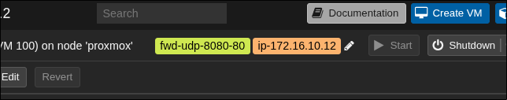

# Moxy



A Proxmox plugin that allows proxying of traffic from a VPS to VMs via easy to configure tags within the Proxmox UI

## Prerequisites
Full step-by-step setup is in [prerequisites.md](prerequisites.md).

1. A WireGuard tunnel between your VPS and Proxmox server. 
2. A Linux network bridge for VMs that you want to expose to the VPS, configured in Proxmox
3. A masquerade to allow VMs on the network bridge to communicate to the internet via your home internet
4. Enable IPv4 forwarding on both machines
5. A restricted SSH key so Proxmox can push nftables rules to the VPS
6. (Optional) DHCP server on the private network bridge to hand out IP addresses to VMs 

## Setup
3 separate, non-overlapping subnets are required:
- WireGuard subnet for communication between the Proxmox server and VPS: 10.0.0.0/24 
- Private home network: 192.168.1.0/24
- Linux network bridge, private to the Proxmox server: 172.16.10.0/24

## ENV

Copy `.env.example` to `.env` and fill it in.

### Required

> PVE_TOKEN_SECRET

This is the token we use to poll proxmox. Run the following commands as root on the proxmox server to generate a token a token under the "moxy" user and "poll" token id.

```
pveum user add moxy@pve
pveum acl modify /vms -user moxy@pve -role PVEAuditor
pveum user token add moxy@pve poll --privsep 0
```

> VPS_WIREGUARD_IP

The VPS WireGuard IP address

> VM_SUBNET

Subnet of the VMs on the private linux bridge

> VPS_USER

Username of the VPS user that you set up ssh for. Should be root or a user that has access to nftables without password

> VPS_WAN_IFACE

Name of the VPS's public network interface, e.g. `eth0` or `ens3`. Run `ip -br addr` on the VPS and pick the one with the public IP.

### Optional

| Variable | Default | Description |
|---|---|---|
| `PVE_URL` | `https://127.0.0.1:8006` | Proxmox API base URL |
| `PVE_TOKEN_ID` | `moxy@pve!poll` | API token ID, `<user>@<realm>!<token name>` |
| `VPS_SSH_PORT` | `22` | SSH port on the VPS |
| `VPS_WG_IFACE` | `wg0` | WireGuard interface name on the VPS |
| `MOXY_SSH_KEY` | `/etc/moxy/id_ed25519` | Private key used to SSH into the VPS |
| `MOXY_KNOWN_HOSTS` | `/etc/moxy/known_hosts` | known_hosts file holding the VPS host key |
